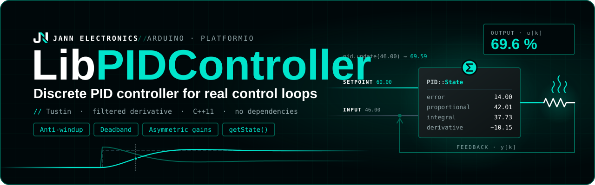

<p align="center">
  
</p>

# LibPIDController

Discrete PID controller for microcontrollers, with the features a real control loop needs and a
full view of what happens inside it.

```cpp
#include "PIDController.h"

PID::Controller pid;

void setup() {
  pid.setGains(2.0f, 0.5f, 0.1f); // Kp, Ki, Kd
  pid.setSampleTimeMs(100);
  pid.setOutputLimits(0.0f, 100.0f);
  pid.setAntiWindupEnabled(true);
  pid.setSetpoint(50.0f);
  pid.setEnabled(true);
}

void loop() {
  // every 100 ms
  float power = pid.update(readTemperature());
}
```

- Tustin (bilinear) discretization of the parallel PID, with a **filtered derivative**.
- Derivative **on measurement** (no kick when the setpoint changes) or on error.
- Output limits with **clamping anti-windup**.
- **Deadband**, **asymmetric gains** (separate gains above and below the setpoint) and
  **stability detection**.
- `getState()` returns **every internal value** of the last iteration (error, P, I, D, output,
  flags) for logging and plotting.
- Invalid parameters are rejected, NAN measurements are ignored, and enabling the controller
  starts from a clean state.
- No dependencies: only `<math.h>` and `<stdint.h>`. Works with Arduino, ESP-IDF or any C++11
  compiler.

## Contents

- [LibPIDController](#libpidcontroller)
  - [Contents](#contents)
  - [Installation](#installation)
  - [Quick start](#quick-start)
  - [How it works](#how-it-works)
    - [Control law](#control-law)
    - [Sample time](#sample-time)
  - [Features](#features)
    - [Output limits and anti-windup](#output-limits-and-anti-windup)
    - [Derivative filter and mode](#derivative-filter-and-mode)
    - [Deadband](#deadband)
    - [Asymmetric gains](#asymmetric-gains)
    - [Stability detection](#stability-detection)
    - [Enable, reset and invalid input](#enable-reset-and-invalid-input)
  - [Logging the internal state](#logging-the-internal-state)
  - [Defaults](#defaults)
  - [API reference](#api-reference)
  - [Thread safety](#thread-safety)
  - [Examples](#examples)
  - [License](#license)

## Installation

**PlatformIO**, in `platformio.ini`:

```ini
lib_deps = https://github.com/Jann-Electronics/LibPIDController.git
```

**Anything else**: copy `src/PIDController.h` and `src/PIDController.cpp` into your project.

```cpp
#include "PIDController.h"
```

Everything lives in the `PID` namespace: `PID::Controller`, `PID::GainMode`,
`PID::DerivativeMode` and `PID::State`.

## Quick start

A heater holding 50 °C, with the output in percent of full power:

```cpp
#include <Arduino.h>
#include "PIDController.h"

constexpr uint8_t HEATER_PIN = 9;
constexpr uint32_t SAMPLE_MS = 100;

PID::Controller pid;

void setup() {
  pid.setSetpoint(50.0f);
  pid.setGains(2.0f, 0.5f, 0.1f);
  pid.setSampleTimeMs(SAMPLE_MS);
  pid.setOutputLimits(0.0f, 100.0f);
  pid.setAntiWindupEnabled(true);
  pid.setEnabled(true); // the controller starts disabled
}

void loop() {
  // update() must run once per sample time: schedule with millis(), not delay()
  static uint32_t last_ms = millis();
  if (millis() - last_ms < SAMPLE_MS) return;
  last_ms += SAMPLE_MS;

  float output = pid.update(readTemperature());
  analogWrite(HEATER_PIN, static_cast<uint8_t>(output * 255.0f / 100.0f));
}
```

## How it works

### Control law

The controller implements the parallel PID with a first-order filter on the derivative:

$$
u(s) = K_p\,E(s) + \frac{K_i}{s}\,E(s) + K_d\,\frac{N\,s}{s + N}\,E(s)
$$

discretized with the Tustin (bilinear) method. With $T$ the sample time in seconds, every call to
`update()` computes:

$$
\begin{aligned}
e[k] &= \text{setpoint} - y[k] \\
P[k] &= K_p\,e[k] \\
I[k] &= I[k-1] + \frac{K_i\,T}{2}\,\big(e[k] + e[k-1]\big) \\
D[k] &= \frac{2\,K_d\,N}{N T + 2}\,\Delta[k] \;-\; \frac{N T - 2}{N T + 2}\,D[k-1] \\
u[k] &= \text{clamp}\big(P[k] + I[k] + D[k],\ \text{min},\ \text{max}\big)
\end{aligned}
$$

where $\Delta[k] = -(y[k] - y[k-1])$ with the derivative on measurement (default) or
$\Delta[k] = e[k] - e[k-1]$ with the derivative on error.

The gains are in continuous-time units: $K_i$ per second and $K_d$ in seconds. **Changing the
sample time does not require retuning.**

The integral stores the accumulated $K_i \cdot e$, not $\int e$. Because of that, changing $K_i$ at
runtime does not make the output jump.

### Sample time

The controller does not measure time: `update()` assumes it is called exactly once every
`setSampleTimeMs()`. If the real period differs, the integral and derivative actions are scaled
wrongly.

- Schedule `update()` with `millis()` (as in the examples), a hardware timer or a FreeRTOS task
  with `vTaskDelayUntil()`, not with `delay()` placed after other work.
- If you change how often `update()` runs, call `setSampleTimeMs()` with the new period.

## Features

### Output limits and anti-windup

```cpp
pid.setOutputLimits(0.0f, 100.0f); // false if min >= max or NAN
pid.setAntiWindupEnabled(true);
```

The output is always clamped to `[min, max]` (default `-100` to `100`).

Without anti-windup, the integral keeps growing while the output is saturated. When the
measurement finally reaches the setpoint, that stored integral has to unwind first, which causes
a large overshoot.

With anti-windup enabled the controller uses **clamping**: the integral is held while the output
is saturated and the next increment would push it further into saturation. It integrates again as
soon as the error changes sign or the output leaves the limit. `getState().integrating` shows
when it is being held.

### Derivative filter and mode

```cpp
pid.setDerivativeFilter(20.0f);                        // N in rad/s, false if <= 0
pid.setDerivativeMode(PID::DerivativeMode::OnMeasurement); // default
```

A pure derivative amplifies measurement noise, so the derivative is low-pass filtered with a pole
at $N$ rad/s (default `20`). A lower $N$ filters more; a higher $N$ reacts faster.

> Keep $N \cdot T < 2$ (for example, $N < 200$ at 10 ms). Above that, the discrete filter
> coefficient becomes positive and the derivative action rings, changing sign on every sample.

| Mode                      | Δ used by the derivative   | Setpoint step                         |
| ------------------------- | -------------------------- | ------------------------------------- |
| `OnMeasurement` (default) | $-(y[k] - y[k-1])$         | no derivative kick                    |
| `OnError`                 | $e[k] - e[k-1]$            | output spike ("derivative kick")      |

Both modes behave the same while the setpoint is constant and the error is outside the deadband.
In both, the first `update()` after a
reset uses Δ = 0, so the controller does not kick on start-up either.

### Deadband

```cpp
pid.setDeadbandThreshold(0.5f); // false if negative or NAN
pid.setDeadbandEnabled(true);
```

While $|e| < \text{threshold}$, the proportional and integral actions see a zero error: P is 0,
the integral is held, and the output settles at the integral (plus derivative) value. The system
stops reacting to small errors and noise without the actuator dropping out. For example, a heater
keeps the power it needs to hold the temperature.

The derivative on measurement keeps acting inside the band, so it still damps the motion.
`getState().in_deadband` tells when the error is inside the band. If your actuator must stop
completely in the band (some motor drives), check that flag and switch the actuator off yourself.

### Asymmetric gains

Some processes respond differently in each direction. A heater, for example, heats actively but
only cools by losing heat to the room. Asymmetric gains use one gain set while the error is
positive and another while it is negative:

```cpp
pid.setGains(4.0f, 0.2f, 1.0f, PID::GainMode::Up);   // error > 0: measurement below setpoint
pid.setGains(1.0f, 0.05f, 1.0f, PID::GainMode::Down); // error < 0: measurement above setpoint
pid.setAsymmetricGainsEnabled(true);
```

| Gain set | Used when                                         |
| -------- | ------------------------------------------------- |
| `Normal` | asymmetric gains disabled (the default)           |
| `Up`     | asymmetric gains enabled and error > 0            |
| `Down`   | asymmetric gains enabled and error < 0            |

With a zero error the current set is kept. Every gain setter and getter takes the set as an
optional last argument (`Normal` by default), including `setDerivativeFilter()`.

> The `Up` and `Down` gains start at 0. Configure both before enabling asymmetric gains, or the
> controller will not act on that side of the setpoint. Disabling asymmetric gains returns to the `Normal` set.
> `getGainMode()` returns the set in use.

### Stability detection

```cpp
pid.setStableErrorThreshold(0.5f); // ±0.5 around the setpoint
pid.setStableSamples(30);          // for 30 consecutive samples (3 s at 100 ms)

if (pid.isStable()) { /* start the next step of the process */ }
```

`isStable()` returns `true` once $|e| \le \text{threshold}$ for the given number of consecutive
`update()` calls, and `false` again as soon as the error leaves the band. Detection is off while
either value is 0 (the default). It is independent of the deadband and uses the raw error.

### Enable, reset and invalid input

- The controller **starts disabled**. While disabled, `update()` returns 0 and only records the
  measurement (`getLastInput()`); nothing is computed.
- `setEnabled()` calls `reset()` whenever the state changes. A re-enabled controller starts clean
  instead of resuming with an integral from minutes ago.
- `reset()` clears the integral, the derivative history, the output and the stability counter. It
  does not change the configuration.
- A NAN or infinite measurement is ignored: `update()` returns the previous output and the state
  is not updated. Without this, a single bad sample would make the integral NAN permanently.
  `getState().input` still shows the value received.
- Setters that can receive an invalid value return `false` and change nothing.

## Logging the internal state

`getState()` returns a `PID::State` with every internal value of the last `update()`. All fields
come from the same iteration, so prefer it over several separate getters when logging.

```cpp
const PID::State s = pid.getState();
Serial.printf("%.2f,%.2f,%.2f,%.2f,%.2f,%.2f\n",
  s.setpoint, s.input, s.proportional, s.integral, s.derivative, s.output);
```

| Field          | Type       | Description                                                       |
| -------------- | ---------- | ----------------------------------------------------------------- |
| `setpoint`     | `float`    | Setpoint used in the last iteration                               |
| `input`        | `float`    | Last measurement passed to `update()` (NAN if it was invalid)     |
| `error`        | `float`    | `setpoint - input`                                                |
| `proportional` | `float`    | Proportional action                                               |
| `integral`     | `float`    | Integral action (accumulated)                                     |
| `derivative`   | `float`    | Derivative action, after the N filter                             |
| `unsaturated`  | `float`    | `proportional + integral + derivative`, before the output limits  |
| `output`       | `float`    | Final output, clamped to `[min, max]`                             |
| `gain_mode`    | `GainMode` | Gain set used in the last iteration                               |
| `enabled`      | `bool`     | Controller enabled                                                |
| `saturated`    | `bool`     | The output was clamped to one of the limits                       |
| `integrating`  | `bool`     | `false` while the anti-windup holds the integral                  |
| `in_deadband`  | `bool`     | The error is inside the deadband                                  |
| `stable`       | `bool`     | Same as `isStable()`                                              |

The [`state_logging`](examples/state_logging/state_logging.cpp) example prints all of them as CSV
for the Arduino Serial Plotter, against a simulated plant, so it runs on any board without
hardware.

## Defaults

| Setting             | Default                      |
| ------------------- | ---------------------------- |
| Enabled             | no                           |
| Setpoint            | 0                            |
| Gains (all sets)    | Kp = Ki = Kd = 0             |
| Derivative filter N | 20 rad/s                     |
| Derivative mode     | `OnMeasurement`              |
| Sample time         | 10 ms                        |
| Output limits       | -100 to 100                  |
| Anti-windup         | disabled                     |
| Deadband            | disabled, threshold 0        |
| Asymmetric gains    | disabled                     |
| Stability detection | off (threshold 0, 0 samples) |

## API reference

`mode` is an optional `PID::GainMode`, `Normal` by default.

| Method                                                                                | Description                                                                   |
| ------------------------------------------------------------------------------------- | ----------------------------------------------------------------------------- |
| `update(input)`                                                                       | Runs one iteration and returns the output. Call once per sample time.         |
| `reset()`                                                                             | Clears the internal state, keeps the configuration.                           |
| `setEnabled(bool)` / `isEnabled()`                                                    | Enables or disables the controller. A change of state resets it.              |
| `setSetpoint(value)` / `getSetpoint()`                                                | Target value.                                                                 |
| `setGains(Kp, Ki, Kd, mode)`                                                          | All three gains of a set.                                                     |
| `setGainProportional(Kp, mode)` / `getGainProportional(mode)`                         | Proportional gain.                                                            |
| `setGainIntegral(Ki, mode)` / `getGainIntegral(mode)`                                 | Integral gain, per second.                                                    |
| `setGainDerivative(Kd, mode)` / `getGainDerivative(mode)`                             | Derivative gain, in seconds.                                                  |
| `setDerivativeFilter(N, mode)` / `getDerivativeFilter(mode)`                          | Derivative filter pole in rad/s. `false` if not positive.                     |
| `setDerivativeMode(DerivativeMode)` / `getDerivativeMode()`                           | Derivative on measurement or on error.                                        |
| `setSampleTimeMs(ms)` / `getSampleTimeMs()` / `getSampleTimeSec()`                    | Period between `update()` calls. `false` if 0.                                |
| `setOutputLimits(min, max)`                                                           | Output range. `false` if `min >= max` or NAN.                                 |
| `setOutputLimitMin(min)` / `setOutputLimitMax(max)`                                   | One limit, validated against the other.                                       |
| `getOutputLimitMin()` / `getOutputLimitMax()`                                         | Current limits.                                                               |
| `setAntiWindupEnabled(bool)` / `isAntiWindupEnabled()`                                | Clamping anti-windup.                                                         |
| `setDeadbandEnabled(bool)` / `isDeadbandEnabled()`                                    | Deadband.                                                                     |
| `setDeadbandThreshold(value)` / `getDeadbandThreshold()`                              | Deadband half-width. `false` if negative.                                     |
| `setAsymmetricGainsEnabled(bool)` / `isAsymmetricGainsEnabled()`                      | Up/Down gain sets by the sign of the error.                                   |
| `getGainMode()`                                                                       | Gain set in use.                                                              |
| `setStableErrorThreshold(value)` / `getStableErrorThreshold()`                        | Stability band. `false` if negative.                                          |
| `setStableSamples(n)` / `getStableSamples()`                                          | Consecutive samples required inside the band.                                 |
| `isStable()`                                                                          | The error stayed inside the stability band long enough.                       |
| `getState()`                                                                          | Snapshot of every internal value (see [State](#logging-the-internal-state)).  |
| `getOutput()`                                                                         | Last output.                                                                  |
| `getLastInput()`                                                                      | Last measurement passed to `update()`.                                        |

## Thread safety

`PID::Controller` is not thread-safe. If `update()` runs in one FreeRTOS task and the setpoint or
gains are changed from another, protect the controller with a mutex, for example with
[LibSafeWrap](https://github.com/Jann-Electronics/LibSafeWrap):

```cpp
SafeWrap<PID::Controller> pid;

// control task
if (!pid.withLock([&](PID::Controller& c) { output = c.update(measurement); },
      pdMS_TO_TICKS(5))) {
  // lock not acquired: keep the previous output for this sample
}

// any other task
bool ok = pid.withLock([](PID::Controller& c) { c.setSetpoint(60.0f); }, pdMS_TO_TICKS(5));
```

`Controller` holds no pointers to itself, so it can be copied safely, for example to keep a backup
of a tuned configuration.

## Examples

| Example                                                         | What it shows                                                                                               |
| --------------------------------------------------------------- | ----------------------------------------------------------------------------------------------------------- |
| [`examples/basic`](examples/basic/basic.cpp)                    | Temperature control of a heater with an LM35 sensor, scheduled with `millis()`                              |
| [`examples/state_logging`](examples/state_logging/state_logging.cpp) | `getState()` logged as CSV against a simulated plant (no hardware), with a setpoint step and stability detection |

To build an example in this repository, select it with `src_dir` in `platformio.ini`.

## License

Released under the [MIT License](LICENSE).
